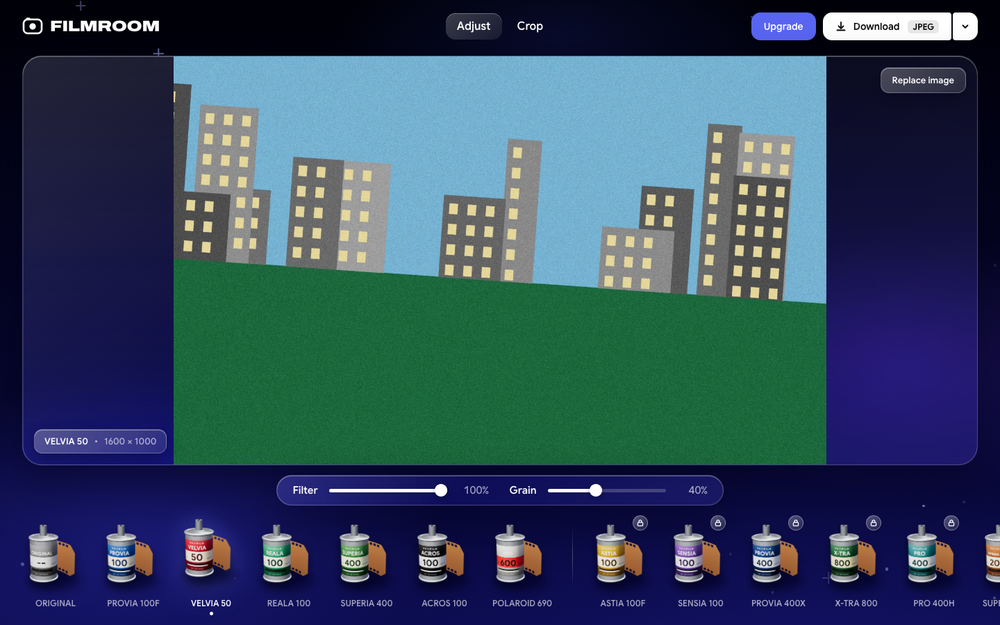

# Filmroom

Give any photo the look of classic Fujifilm, Kodak, Ilford and Polaroid film stocks, add grain, crop and straighten, then download it in the format you want. Everything runs in your browser, so your photos never leave your device.

**[Open the app](https://filmroom.in)**



## Features

- **Many photos at once:** drop or pick as many as you like. Each photo keeps its own film look, grain, adjustments and crop, **Apply look to all** copies one photo's look to the rest, and **Download all** saves every edited photo in one ZIP.
- **Film looks (20):** Fujifilm Provia 100F, Provia 400X, Velvia 50, Astia 100F, Reala 100, Sensia 100, Superia 400, X-Tra 800, Pro 400H, Superia XPRO, FP-100C (and Neg) and Acros 100; Kodak Portra 400, Kodachrome 64, Ektar 100, Ektachrome 100 and Tri-X 400; Ilford HP5 Plus 400; and Polaroid 690.
- **Filter strength:** blend each look from 0 to 100%.
- **Film grain:** adjustable, scaled to the photo's resolution.
- **Adjustments:** exposure, contrast, highlights and shadows sliders (−100 to +100) that sit on top of the film look.
- **Crop and straighten:** aspect-ratio presets, a manual straighten slider, and auto-straighten that finds the horizon or vertical lines.
- **Any format in:** JPG, PNG, WebP, AVIF, BMP, GIF, HEIC and TIFF.
- **Any format out:** the same format as the original, or PNG, JPEG, WebP, TIFF and BMP (AVIF where the browser supports it). Browsers can't write HEIC, so those photos save as JPEG.
- **Full resolution:** processing happens on the GPU at the photo's original size.

## Plans and payments

Payments are handled by [Dodo Payments](https://dodopayments.com) (hosted checkout, tax and invoices). A small API in [`server/`](server/) (a Cloudflare Worker) verifies the Google sign-in, creates the checkout, receives Dodo's signed webhook and is the only thing that can grant a plan. The page only asks the server what plan the account has. Setup, deployment and the test-to-live checklist are in [server/README.md](server/README.md).

| | Free | Pro Monthly | Pro Yearly | Lifetime |
|---|---|---|---|---|
| Price (₹, incl. GST) | 0 | 149 / month | 1,499 / year | 3,499 once |
| Film looks to download | Original + 5 (all 20 can be previewed) | All 20 | All 20 | All 20 |
| Photos open at once | 25 | 25 | 25 | 25 |
| Largest file / resolution | 20 MB / 24 MP | 60 MB / 60 MP | 100 MB / 100 MP | 150 MB / 120 MP |
| Downloads per day | 10 | unlimited | unlimited | unlimited |
| Export size and formats | 1024 px, JPEG and PNG | Original size, all formats | Same | Same |
| "Download all" ZIP | not included | up to 25 photos | up to 25 | up to 25 |

Every rule, where it is enforced and the test that proves it is in [docs/BUSINESS_RULES.md](docs/BUSINESS_RULES.md). The numbers live in one table (`LIMITS` in `index.html`). Locked looks show a lock on their cartridge, and hitting any limit opens the plan picker (Free) or shows a plain message (paid).

## Legal

[Terms of Service](terms/index.html) (plans, renewals, refunds) and [Privacy Policy](privacy/index.html) are static pages served at `/terms/` and `/privacy/`. They are linked from the sign-in screen, the payment screens, the analytics notice and the Account page. If the product, the data it collects or the refund policy changes, update the pages and the date at the top. Have them reviewed by a lawyer before relying on them.

## Analytics

Google Analytics 4 tracks the growth funnel (visit, photo added, download, paywall, plans, checkout, purchase) and never photos, file names, emails or account ids. It stays off until a Measurement ID is set. Growth numbers by day or month, funnels, audiences and churn: [docs/ANALYTICS.md](docs/ANALYTICS.md) (`python3 server/scripts/ga-growth.py --by month`).

## Security and tests

Identity, plans, billing and the signed-in Free download count are owned by the server, so a plan can't be granted from the browser. What a determined user can still do, and why, is in [SECURITY.md](SECURITY.md), together with the penetration-test and verification report.

Tests (all local, no network, no money):

- **Server unit tests (54):** `cd server && npm test`. Webhook signatures, Google token checks, plan rules, webhook handling.
- **Server end-to-end (43):** with the Worker and `node server/test/mock-dodo.mjs` running, `node server/test/e2e-local.mjs`. The whole purchase, renewal, cancel, refund and delete flow against a mock Dodo.
- **Browser suite (93):** same two processes plus `python3 -m http.server 8731`, then open <http://localhost:8731/tests/run.html> (`?only=ACC-7,SRV-1` runs just those). After editing any inline script, run `python3 tools/update-csp.py` to refresh the content-security policy.

## Accounts (Google sign-in)

Plans belong to an account. Buying a plan needs a sign-in. The account dialog has three tabs: **General** (profile, sign-in method, delete account), **Plan & billing** (change plan, cancel or resume, billing portal, invoices as PDF) and **Usage** (today's downloads against the plan's limits).

"Continue with Google" gives the page a Google ID token. The server checks its signature, audience, issuer, expiry and freshness, then issues a revocable session token that the page keeps and sends with each request. Google sign-in needs `https://filmroom.in` (and `http://localhost:8731` for local work) under *Authorized JavaScript origins* of the OAuth client.

## How it works

The film looks are 3D colour lookup tables (Hald CLUTs) applied in a WebGL2 shader with trilinear interpolation. Cropping and rotation happen in the same shader, so an unrotated crop is a pixel-exact cut-out. The film cartridges on the shelf are 3D models rendered once with three.js (`tools/render-cartridges.html`) and shipped as small images in `assets/films/`, so the page never loads three.js.

It is a single `index.html` with no build step. To run it locally, serve the folder over HTTP (the lookup tables can't load from `file://`):

```sh
python3 -m http.server 8000
```

Then open <http://localhost:8000>.

## Credits

The film simulation lookup tables are from the [RawTherapee Film Simulation Collection](https://rawpedia.rawtherapee.com/Film_Simulation) by Pat David, Pavlov Dmitry and Michael Ezra, licensed [CC BY-SA 4.0](https://creativecommons.org/licenses/by-sa/4.0/). They approximate the look of each film and are not the manufacturers' own processing. (Kodak Ektar 100 is published as a finer 256-step table; it is resampled to the 144-step size used here.) Film and brand names are used for identification only, with no affiliation or endorsement.

Auto-straighten, HEIC and TIFF decoding use [heic2any](https://github.com/alexcorvi/heic2any) and [UTIF.js](https://github.com/photopea/UTIF.js), loaded on demand.

## About me

Hi, I'm Siddharth. Filmroom is a small project I designed and built with [Claude Code](https://claude.com/claude-code). You can find me on GitHub at [@SiddharthSimharaju](https://github.com/SiddharthSimharaju).
